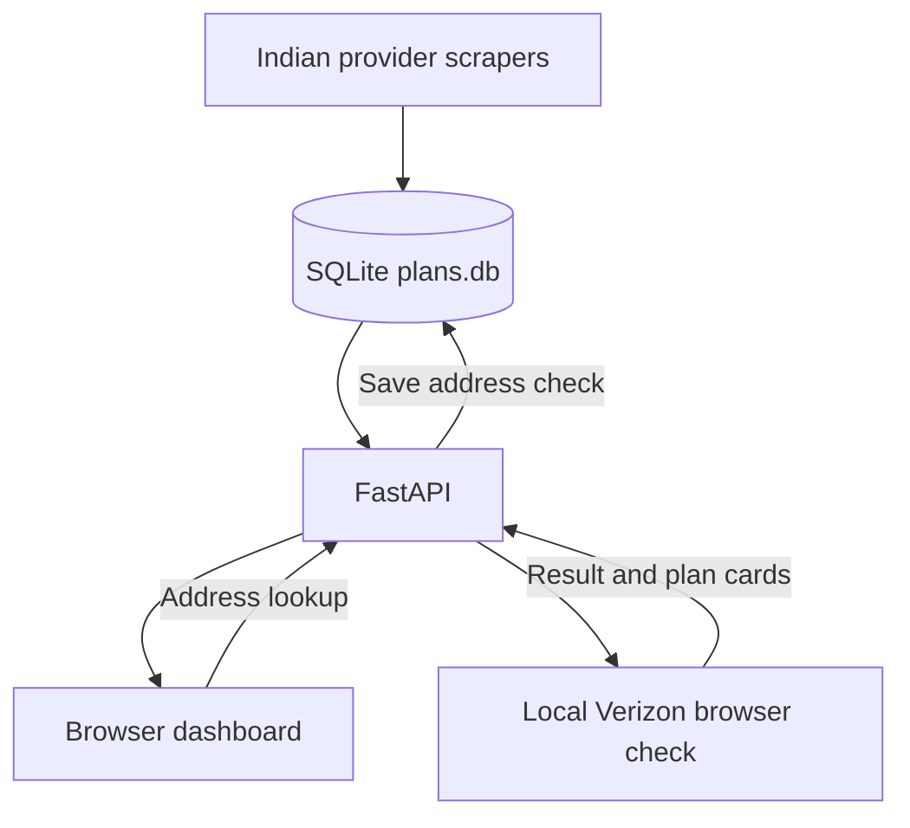

# Broadband Plan Scraping and Comparison

A Python project for collecting residential broadband plans, saving results in SQLite, exposing them through FastAPI, and displaying them in a browser dashboard.

The project covers **JioFiber, ACT Fibernet, Hathway, and Verizon**, with a separate **Spectrum availability inspector**. Indian provider scrapers use Playwright connected to Browserbase. Verizon uses local Chromium to check an address and inspect the resulting residential plans.

> This is a development and research project. Provider pages, selectors, prices, address requirements, and offers can change. A successful browser request does not by itself confirm service availability or a database write.

## Contents

- [Provider coverage and current status](#provider-coverage-and-current-status)
- [How the application works](#how-the-application-works)
- [Technology](#technology)
- [Project files](#project-files)
- [Install and configure](#install-and-configure)
- [Start the API and dashboard](#start-the-api-and-dashboard)
- [Scrape Jio, Hathway, and ACT](#scrape-jio-hathway-and-act)
- [Check Verizon residential availability](#check-verizon-residential-availability)
- [Recover Verizon plans from a capture](#recover-verizon-plans-from-a-capture)
- [Inspect Spectrum](#inspect-spectrum)
- [API reference](#api-reference)
- [SQLite storage](#sqlite-storage)
- [Frontend features](#frontend-features)
- [Inspection and benchmarking tools](#inspection-and-benchmarking-tools)
- [Troubleshooting](#troubleshooting)
- [Limitations and next steps](#limitations-and-next-steps)

## Provider coverage and current status

| Provider | Scope | Browser | Persistence and status |
| --- | --- | --- | --- |
| JioFiber | Plans returned by the configured JioFiber page; optional recognized duration tabs | Browserbase + Playwright | Validated records are saved in `plans`. The saved data does not establish a city. |
| ACT Fibernet | Chennai main plan table | Browserbase + Playwright | Saved in `provider_plans`; parser expects four packs with seven speed entries each. Billing period and taxes remain unverified. |
| Hathway | Chennai plan section | Browserbase + Playwright | Saved in `provider_plans`, including captured conditions. Billing period remains unconfirmed. |
| Verizon | Residential internet at a submitted US address | Local Playwright Chromium | Address checks and parsed offer cards are saved through the API or CLI `--save-db`. The sales parser is validated against captured 5G Home Ultimate, Plus, and Home cards. |
| Spectrum | Address and optional unit availability inspection | Local Chromium by default; Browserbase optional | Writes diagnostic captures and result JSON. It is not connected to the plan database or dashboard. |

**Committed Verizon version:** `verizon-sales-cards-fix-6`. This revision can report unit requirements or a resolved-unit mismatch, but it does **not** expose a separate Verizon `--unit` argument, API request field, or frontend unit input. Completing automatic unit entry and verifying the live flow are remaining tasks. Spectrum has its own separate `--unit` option.

Captured plan counts and prices are observations from particular runs, not a permanent catalogue or a guarantee of current offers.

## How the application works



There are two main workflows:

1. **Saved Indian provider plans:** run the provider scrapers, validate their extracted fields, commit them to SQLite, then read them through the API and dashboard.
2. **Verizon address lookup:** submit an address in the dashboard or API, launch local Chromium, enter the address, select a matching suggestion, wait for the sales result, parse supported plan cards, save the result, and display its status.

The API serves the frontend from the same origin. You do not need a separate Node.js application, frontend build step, or frontend development server.

## Technology

| Component | Purpose |
| --- | --- |
| Python 3.11 recommended | Scraper scripts, orchestration, database access, and API |
| Playwright | Navigate pages, wait for controls, enter addresses, and extract DOM content |
| Browserbase | Host the browser sessions used by the Indian provider scrapers |
| FastAPI + Uvicorn | Serve the API and frontend |
| SQLite | Store provider snapshots and address-check history locally |
| python-dotenv | Load local configuration from `.env` |
| HTML, CSS, JavaScript | Display and compare saved plans and run Verizon lookups |

SQLite is part of Python's standard library. The Python packages are listed in [requirements.txt](requirements.txt); dependency versions are currently unpinned.

## Project files

| Path | Responsibility |
| --- | --- |
| `api.py` | FastAPI application, provider endpoints, Verizon lookup and saved-result endpoints, protected Swagger pages, and frontend serving |
| `database.py` | SQLite path, table creation, validated writes, and latest Verizon result retrieval |
| `frontend/index.html` | Dashboard, filters, comparison, export, database status, and Verizon address lookup |
| `main_scrapers.py` | Run Jio, Hathway, and ACT scripts as separate subprocesses with configurable concurrency |
| `scrape_jio_browserbase.py` | Extract JioFiber cards, validate required values, and save them |
| `scrape_act_browserbase.py` | Parse the ACT Chennai main table and validate its pack/speed structure |
| `scrape_hathway_browserbase.py` | Extract Hathway Chennai speed, price, and conditions |
| `inspect_verizon.py` | Local address inspection, matching suggestions, supported sales-card parsing, capture recovery, and optional database save |
| `inspect_spectrum.py` | Parameter-driven Spectrum inspection and diagnostic capture |
| `inspect_jio.py`, `inspect_jio_tabs.py` | Inspect the Jio page and its controls/tabs |
| `inspect_act.py`, `inspect_hathway.py` | Inspect provider pages before changing extraction selectors |
| `explore_website.py` | Bounded exploration of configured tabs, dropdowns, menus, and same-site links; capture output only |
| `view_plans.py` | Print records from the legacy `plans` table, primarily JioFiber |
| `benchmark.py` | Measure repeated requests to the local `/plans` endpoint |
| `requirements.txt` | Python dependencies |
| `.gitignore` | Ignore local environment, database, logs, and common capture paths |
| `README.txt` | Pointer to this project guide |

Generated files include `plans.db`, `captures/`, and timestamped `logs/` directories. They are created when the corresponding tools run.

## Install and configure

### 1. Clone the repository

Run these commands in PowerShell:

```powershell
git clone https://github.com/surothaaman/WEB-SCARPING-FOR-JIO-ACT-HATHWAY-VERZION-.git broadband-plan-comparison
cd broadband-plan-comparison
```

If you already have the project locally, open that existing folder instead of cloning another copy.

### 2. Create the Python environment

```powershell
python -m venv .venv
.\.venv\Scripts\python.exe -m pip install -r requirements.txt
.\.venv\Scripts\python.exe -m playwright install chromium
```

Using the virtual environment's Python directly avoids PowerShell activation-policy issues and makes sure installation and execution use the same interpreter.

For macOS/Linux, use `.venv/bin/python` in place of `.\.venv\Scripts\python.exe`.

### 3. Configure `.env`

Create a file named `.env` beside `api.py`:

```dotenv
BROWSERBASE_API_KEY=replace_with_your_browserbase_api_key
BROWSERBASE_PROJECT_ID=replace_with_your_browserbase_project_id
DOCS_USERNAME=localadmin
DOCS_PASSWORD=replace_with_a_strong_local_password
```

| Variable | Used by |
| --- | --- |
| `BROWSERBASE_API_KEY` | Browserbase provider scripts and cloud inspection modes |
| `BROWSERBASE_PROJECT_ID` | Select the Browserbase project for browser sessions |
| `DOCS_USERNAME` | HTTP Basic username for `/docs` and `/openapi.json` |
| `DOCS_PASSWORD` | HTTP Basic password for `/docs` and `/openapi.json` |

Local Verizon checks and local Spectrum inspection do not require Browserbase credentials. Browserbase runs require available session capacity and browser minutes on the account.

Keep real credentials in your local `.env`. Browser captures can contain addresses and browser/session information. The current ignore rules cover `captures/`, but arbitrary ZIP archives or recovered result JSON in the repository root are not covered. Already tracked files also remain tracked after adding an ignore rule.

### 4. Initialize the database

```powershell
.\.venv\Scripts\python.exe database.py
```

This creates missing tables in `plans.db` beside `database.py`. API startup also calls table initialization. This command does not fetch provider plans.

## Start the API and dashboard

From the project root:

```powershell
.\.venv\Scripts\python.exe -m uvicorn api:app --host 127.0.0.1 --port 8000 --reload
```

Open:

- Dashboard: [http://127.0.0.1:8000/](http://127.0.0.1:8000/)
- Swagger: [http://127.0.0.1:8000/docs](http://127.0.0.1:8000/docs)
- Database status: [http://127.0.0.1:8000/database-status](http://127.0.0.1:8000/database-status)

Swagger prompts for the credentials configured in `.env`. If those values are missing, the documentation endpoints return HTTP 503; incorrect credentials return HTTP 401.

**Authentication scope:** Basic authentication is applied to `/docs` and `/openapi.json`. It is not applied to the plan endpoints or the Verizon lookup endpoint. The app is currently designed for local development. `--reload` is a development setting.

## Scrape Jio, Hathway, and ACT

### Run all three

```powershell
.\.venv\Scripts\python.exe main_scrapers.py
```

The default is **three concurrent workers**. Each provider runs in its own subprocess using the same Python interpreter. The runner saves separate provider logs in a timestamped `logs/` folder and prints a summary.

Use fewer workers when cloud session limits, resource usage, or database contention require it:

```powershell
.\.venv\Scripts\python.exe main_scrapers.py --workers 1
```

`--workers` accepts `1`, `2`, or `3`. Each child script has a 240-second runner timeout. The runner also uses `.scrapers-running.lock` to avoid overlapping runner processes.

Explore recognized Jio plan tabs while running the three scripts:

```powershell
.\.venv\Scripts\python.exe main_scrapers.py --full
```

`--full` forwards `--all-tabs` to Jio only. It is not an exhaustive crawl of every provider menu. The runner does not launch Verizon or Spectrum.

### Run one provider

```powershell
.\.venv\Scripts\python.exe scrape_jio_browserbase.py
.\.venv\Scripts\python.exe scrape_hathway_browserbase.py
.\.venv\Scripts\python.exe scrape_act_browserbase.py
```

Jio also supports:

```powershell
.\.venv\Scripts\python.exe scrape_jio_browserbase.py --all-tabs
.\.venv\Scripts\python.exe scrape_jio_browserbase.py --block-assets
```

The tab mode only visits recognized duration tabs. Asset blocking skips matching image, font, and video URLs; it is optional and is not a guarantee of faster or equivalent extraction on every page version.

### Validate an ACT capture offline

```powershell
.\.venv\Scripts\python.exe scrape_act_browserbase.py --html .\captures\act_scraped_page.html
```

This checks an existing HTML capture without network access or a database write. The capture file must already exist. The parser rejects a table that no longer matches its expected four-pack, seven-speed structure.

After a live scrape, check `/database-status` or the dashboard's database panel to verify stored records and timestamps. A runner exit status describes the child process; independently inspect stored data when validating the complete pipeline.

## Check Verizon residential availability

### Through the dashboard

1. Start the API and open the dashboard.
2. Enter the intended residential street address, city/state, and optional ZIP.
3. Click **Check address** to run a new local browser lookup.
4. Read the status, requested address, resolved service address, plan cards, and pricing conditions.
5. Use **Load saved result** to read the latest stored lookup for the same full address without starting another browser.

The current API launches a **visible local Chromium browser on the computer running Uvicorn**. It does not use Browserbase for Verizon. Keep that browser open while the lookup runs.

The scraper handles the initial read-only address launcher, waits for an editable field, enters the address, and selects a uniquely matching autocomplete suggestion. It waits for supported sales cards rather than treating navigation alone as a completed result.

If Verizon adds an apartment/unit to the resolved address, that unit must be checked against the intended home. `unit_confirmation_required` does not mean all units in the building have the displayed offers. Automatic entry into a separate unit control is a known gap in the committed revision.

### Through the command line

Replace the address placeholder before running:

```powershell
.\.venv\Scripts\python.exe inspect_verizon.py --address "YOUR STREET ADDRESS, CITY, ST ZIP"
```

Useful options:

| Option | Behavior |
| --- | --- |
| `--address` | Required residential address |
| `--zip` | Optional ZIP, appended when it is not already present |
| `--wait-seconds` | Result wait limit; default `90`, accepted range `10`–`600` |
| `--headless` | Run local Chromium without a visible window |
| `--save-db` | Save the result and any captured plans in SQLite |
| `--capture-text` | Reprocess a previously saved sales-page text capture |

For example, save a fresh lookup:

```powershell
.\.venv\Scripts\python.exe inspect_verizon.py --address "YOUR STREET ADDRESS, CITY, ST ZIP" --wait-seconds 120 --save-db
```

The CLI saves diagnostics by default. Database storage requires `--save-db`; the API lookup endpoint saves its returned result automatically.

### Understand the result

| Status | Meaning |
| --- | --- |
| `available` | The parser recognized availability for the displayed address |
| `unavailable` | Explicit unavailability wording was detected |
| `unit_required` | A unit is required before the lookup can continue |
| `unit_confirmation_required` | The resolved unit needs confirmation before associating offers with the requested home |
| `address_mismatch` | The service address differs from the request |
| `ambiguous_address` | No unique autocomplete suggestion matched the supplied address components |
| `needs_review` | Candidate offers were captured but address confirmation is incomplete |
| `needs_support` | Verizon could not continue the online flow |
| `verification_required` | A security check was detected |
| `incomplete` | No completed recognized result appeared within the wait limit |
| `timeout` | A page control exceeded its wait timeout |
| `browser_closed` | The page/browser closed; inspect the error and stage before inferring a cause |
| `external_redirect` | Navigation left the allowed Verizon host scope |
| `error` | Another error occurred; inspect the saved details |

Use `service_available` and each plan's `address_confirmed` flag alongside the status and message. A null availability value means the lookup did not establish availability for the requested home.

Prices are stored separately because they describe different conditions: advertised monthly price, an eligible mobile-bundle price, and the Broadband Facts monthly price before discounts. Do not treat the lowest displayed amount as an unconditional price.

## Recover Verizon plans from a capture

The recovery path can extract supported cards from a completed sales-page capture even if an earlier parser missed them.

Keep these files together in the original capture folder:

- `verizon_page_text.txt`
- `verizon_result.json`

Use the same address as the original lookup:

```powershell
.\.venv\Scripts\python.exe inspect_verizon.py --address "THE ORIGINAL CAPTURED ADDRESS" --capture-text .\captures\YOUR_CAPTURE_FOLDER\verizon_page_text.txt --save-db
```

Recovery validates the original address, reparses the text without opening a browser, preserves the original capture timestamp, and records a recovery timestamp. It cannot obtain plans that were never present in the saved page. Address and unit confirmation rules still apply to recovered offers.

## Inspect Spectrum

Spectrum is an inspection tool, not an integrated plan-import adapter:

```powershell
.\.venv\Scripts\python.exe inspect_spectrum.py --browser local --address "YOUR STREET ADDRESS" --zip "YOUR_ZIP"
```

Use a real five-digit ZIP. Add `--unit` with the actual apartment/unit when needed:

```powershell
.\.venv\Scripts\python.exe inspect_spectrum.py --browser local --address "YOUR STREET ADDRESS" --zip "YOUR_ZIP" --unit "YOUR_ACTUAL_UNIT"
```

For a cloud session, use `--browser browserbase` and configure Browserbase credentials. The default result wait is 600 seconds; `--wait-seconds 0` disables the script's result deadline but does not remove Browserbase account/session limits. The default cloud session limit is 1800 seconds.

The tool saves HTML, text, control metadata, and result JSON. Possible localized offers remain subject to review; generic marketing prices do not establish service availability at the supplied address.

## API reference

Base URL for local development: `http://127.0.0.1:8000`.

| Method | Endpoint | Purpose |
| --- | --- | --- |
| GET | `/` | Serve the dashboard |
| GET | `/plans` | Read the legacy `plans` table, currently used for JioFiber |
| GET | `/plans/jio` | Read saved JioFiber records |
| GET | `/plans/hathway` | Read saved Hathway records |
| GET | `/plans/act` | Read saved ACT records |
| GET | `/provider-plans` | Read the `provider_plans` table; optional `provider` filter |
| POST | `/verizon/check` | Run a local address check, save its result, and return it |
| GET | `/verizon/results?address=...` | Read the latest stored Verizon check for the normalized full address |
| GET | `/database-status` | Show the SQLite path, file size, table/provider counts, and capture timestamps |
| GET | `/docs` | Swagger UI; requires configured Basic authentication |
| GET | `/openapi.json` | OpenAPI schema; requires configured Basic authentication |

Example saved-data requests:

```powershell
Invoke-RestMethod http://127.0.0.1:8000/plans/jio
Invoke-RestMethod "http://127.0.0.1:8000/provider-plans?provider=ACT"
Invoke-RestMethod http://127.0.0.1:8000/database-status
```

Example live Verizon request:

```powershell
$address = "YOUR STREET ADDRESS, CITY, ST ZIP"
$body = @{ address = $address; wait_seconds = 90 } | ConvertTo-Json
$result = Invoke-RestMethod -Uri "http://127.0.0.1:8000/verizon/check" -Method Post -ContentType "application/json" -Body $body -TimeoutSec 180
$result | ConvertTo-Json -Depth 8
```

The committed request model accepts `address`, optional `zip_code`, and `wait_seconds`. A separate `unit` request parameter is not implemented in this revision.

Read the saved result using the same full address, including the ZIP if it was appended during the original request:

```powershell
$encodedAddress = [uri]::EscapeDataString($address)
Invoke-RestMethod "http://127.0.0.1:8000/verizon/results?address=$encodedAddress"
```

Saved plan reads return a `total` and `plans` collection. A saved Verizon lookup with no matching record returns `found: false`. A live lookup can return HTTP 200 with a domain status such as `incomplete` or `needs_review`; examine the JSON, not just the HTTP status.

API validation can return HTTP 422; missing dependencies can produce HTTP 503, and unexpected lookup failures can produce HTTP 502. The result wait does not include all browser startup, navigation, capture, and cleanup time.

## SQLite storage

`DB_PATH` is defined in `database.py` as `plans.db` beside that file. Use `/database-status` to see the exact file used by the running API.

| Table | Contents | Save behavior |
| --- | --- | --- |
| `plans` | Jio provider, displayed price, validity, data/speed text, source URL, and UTC scrape time | Replace the matching provider/source snapshot in a transaction after validation |
| `provider_plans` | Provider, city, advertised price in integer paise, speed in Mbps, billing period, conditions JSON, source URL, and UTC scrape time | Replace the matching provider/city/source snapshot in a transaction |
| `address_checks` | Requested address, normalized lookup key, provider, status, nullable availability, currency, message, source URL, timestamps, and full result JSON | Append one record for each Verizon check |
| `address_check_plans` | Check reference, plan name, monthly price, speed, billing period, confirmation flag, and raw offer text | Insert alongside the corresponding address check in the same transaction |

Indian prices use integer paise in `provider_plans` to avoid floating-point money rounding. Verizon's normalized monthly-price column uses a SQLite real value; supplementary pricing fields, conditions, and the resolved address are retained in the complete result JSON and exposed by saved-result retrieval.

SQL values use parameterized queries. Invalid or empty provider results are rejected before replacing the saved snapshot. Address checks keep a history, including incomplete and unconfirmed lookups; the latest saved check may therefore be a failed lookup rather than an earlier successful one.

`view_plans.py` reads only `plans`:

```powershell
.\.venv\Scripts\python.exe view_plans.py
```

Use provider API endpoints or `/database-status` to inspect the other tables. The database-status total includes address-check records; it is not a count of Verizon plan rows.

## Frontend features

- Browse saved Jio, ACT, and Hathway plans.
- Filter by provider, search text, minimum speed, and maximum advertised INR price.
- Sort by provider/price, advertised price, or speed.
- Select up to three Indian provider plans for a side-by-side comparison.
- View captured conditions, source links, and timestamps.
- Export saved Indian plan rows to CSV.
- Inspect database storage and provider record counts.
- Run a Verizon address lookup or load a saved address result.
- Display Verizon advertised prices, conditional bundle prices, Broadband Facts prices, and address/unit review messages.

Saved Indian provider data refreshes every five seconds while the tab is visible. **Refresh saved plans** reads SQLite through the API; it does not run the provider scrapers. Capture timestamps identify the saved scrape/check time, while the database check time identifies when the API was queried.

Verizon results occupy a separate section. They are not mixed into the INR comparison filters or the Indian plan CSV export. Spectrum results are not displayed in the dashboard.

## Inspection and benchmarking tools

Use the provider inspection scripts to inspect changed markup before editing selectors. `explore_website.py` can capture configured tab, dropdown, menu, and same-site link views. Its exploration is bounded and configured, not an automatic exhaustive website crawler or a generic database importer.

```powershell
.\.venv\Scripts\python.exe explore_website.py "https://www.actcorp.in/broadband/chennai/broadband-plans" --max-pages 3 --max-views 10
```

Only configure controls that navigate or filter the plan views you intend to inspect.

With the API running, measure the legacy plan-read endpoint:

```powershell
.\.venv\Scripts\python.exe benchmark.py
```

The benchmark reports the first request and ten repeated `/plans` requests, including mean, median, fastest, and slowest response times. It measures local API reads, not provider scraping latency. The runner and individual scrapers report their own elapsed times. There is no fixed seconds-level completion guarantee.

## Troubleshooting

| Problem | What to check |
| --- | --- |
| `ModuleNotFoundError` | Install `requirements.txt` with the same `.venv` Python used to run the app. |
| Chromium executable missing | Run `.\.venv\Scripts\python.exe -m playwright install chromium`. |
| Browserbase HTTP 402 | Check the account's available browser minutes/billing. Increasing a script timeout does not restore quota. |
| Browserbase session/capacity errors | Verify credentials and project ID; retry with `--workers 1` when concurrency exceeds available capacity. |
| `ERR_NAME_NOT_RESOLVED` | Verify DNS and network access to the provider from the machine running the browser. |
| Swagger HTTP 503 | Set `DOCS_USERNAME` and `DOCS_PASSWORD` in the project `.env`, then restart the API. |
| Swagger HTTP 401 | Enter the configured documentation username and password. |
| Port 8000 already in use | Stop the existing Uvicorn process or choose another port and open its matching URL. |
| Dashboard has no saved Indian plans | Run the scrapers, inspect their logs, and verify `/database-status`. Starting the API alone does not fetch those plans. |
| Old values remain after a scrape | Check that the scraper committed successfully and that the API is using the same `plans.db`. |
| `.scrapers-running.lock` blocks a run | Confirm no runner is active before removing a lock left by a crashed run. |
| ACT rejects the main table | Inspect fresh HTML; the parser intentionally rejects a structure that differs from its four-pack/seven-speed expectation. |
| Verizon stops on a read-only address box | Check the logged inspector revision and captures; the visible box may launch a separate editable widget. |
| Verizon asks for a unit | Use the actual intended unit and inspect the captured controls; automatic unit-field entry remains a gap in the committed revision. |
| Verizon returns `incomplete` or `needs_review` | Inspect the result JSON, sales-page text, control capture, and resolved address before changing the parser. |
| `browser_closed` | Inspect `stage`, `error_detail`, and `browser_events`. A close/disconnect event alone does not prove that the provider blocked the session. |
| Security challenge | The inspectors report the challenge; they do not solve or bypass it. |

For Verizon diagnostics, the most useful files from the latest timestamped capture folder are `verizon_result.json`, `verizon_page_text.txt`, `verizon_controls.json`, and `verizon_page.html`. `verizon_initial.html` records an earlier page state when available. A browser that closes early may leave only partial captures.

## Limitations and next steps

Current limitations:

- Selectors and layout assumptions are provider-specific and can break when a website changes.
- The supported Verizon sales parser covers the captured 5G Home card layout; it is not a universal Fios/5G/other-plan parser.
- Separate Verizon unit input and its live end-to-end verification remain pending in this committed version.
- Spectrum is diagnostic-only and has no validated plan import/API/frontend pipeline.
- ACT and Hathway advertised amounts do not establish a monthly billing period or verified total cost.
- Jio data does not establish a city, and optional tab exploration is limited to recognized labels.
- Data refresh depends on running scrapers; no recurring scheduler is configured.
- The API's application endpoints are not authenticated, and browser lookup requests do not use a background-job queue.
- No automated test suite or CI workflow is currently committed. Offline capture checks and prior captured-page/database validation do not replace a fresh live browser test.

Suggested development order:

1. Complete and validate the Verizon unit flow across scraper, API, and frontend.
2. Add sanitized capture fixtures and regression tests for supported plan layouts.
3. Expand Verizon adapters only after inspecting representative address-specific result pages.
4. Validate a Spectrum result adapter before importing its offers into SQLite.
5. Pin dependencies and add CI for offline parser/database tests.
6. Add endpoint authentication, background jobs, and scheduling when moving beyond local development.

Keep capture fixtures sanitized and label historical example offers with their capture date. Verify current terms and availability with the provider before using a plan result for a real purchase decision.
